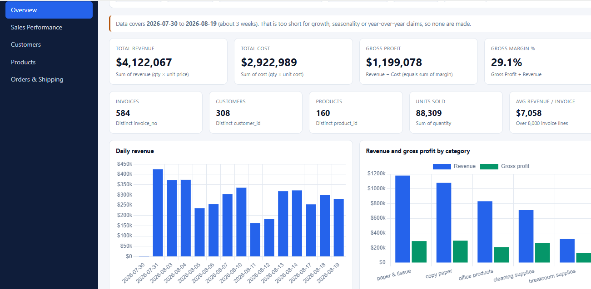
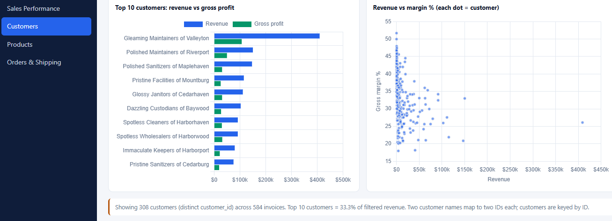
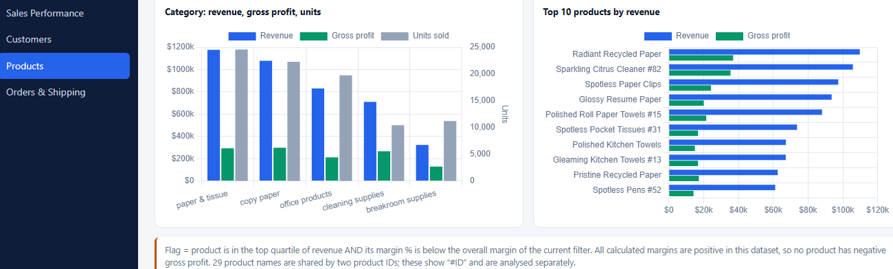

# B2B Sales Intelligence Dashboard
A business intelligence dashboard built from cleaned B2B invoice data to help stakeholders understand revenue, cost, gross profit, margin, customer contribution, product performance, and fulfillment efficiency.
1. Overview
 
 headline KPIs
- total revenue, cost, gross profit, and margin
-  invoice, customer, and product counts
- category-level performance summary
  
## 2. Sales Performance

- daily and weekly performance trends
- revenue, cost, and gross profit over time
- gross margin analysis by period
  


## 3. Customers

 - top customers by revenue and gross profit
 - customer contribution analysis
 - profitability comparison across customer accounts
   

 
## 4. Products

 - product and category contribution analysis
 - top-performing products by revenue and gross profit
 - product mix insights
   

  
## 5. Orders & Shipping

   - order date vs. ship date analysis
   - invoice-level shipping duration
   - shipping distribution by day count
     
 

This project turns raw transactional invoice data into an executive-ready sales intelligence dashboard. Instead of forcing business users to inspect rows of data manually, it summarizes the numbers into clear KPIs and visual insights that answer the questions leaders actually care about.

The dashboard focuses on the core commercial questions behind B2B performance:
- How much revenue and gross profit were generated?
- Which customers and products are driving the strongest results?
- How do sales and profitability trend over time?
- Where is margin being created or lost?
- How long does it take to fulfill orders after they are placed?

This project is especially relevant for roles in:
- Business Intelligence
- Data Analytics
- Sales Analysis
- Commercial Reporting
- Operations Analysis
- Product and Revenue Analysis
- Dashboard: [REPORTS/index.html](REPORTS/index.html)
- FAQ: [REPORTS/FAQ.md](REPORTS/FAQ.md)
********************************************************************************************************************************************************************************************************************************************************************************************************************************************************************************
This is a portfolio-style BI project designed to demonstrate analytical thinking, business storytelling, data validation, and dashboard design in a way that is easy for non-technical stakeholders to understand.

## Why this project matters

Most organizations do not have a data problem — they have a clarity problem.

This project shows how raw sales data can be converted into meaningful business insight. It demonstrates how to:
- validate calculations against source data
- define and communicate KPI logic
- segment performance by customer and product
- identify operational bottlenecks
- visualize trends in a way that supports business decision-making


## Verified headline metrics

The dashboard is built from a cleaned B2B invoice dataset, and the following headline metrics were validated against the source data:

| Metric | Value |
|---|---:|
| Invoice-line records | 8,000 |
| Revenue | $4,122,067.37 |
| Cost | $2,922,989.00 |
| Gross profit | $1,199,078.37 |
| Gross margin | 29.09% |
| Distinct invoices | 584 |
| Distinct customers | 308 |
| Distinct products | 160 |
| Units sold | 88,309 |

These figures are dataset-specific and should be interpreted as business insights derived from the included prototype dataset rather than live business results.

## Business logic and KPI definitions

The dashboard applies the following business definitions:
- Revenue = sum of revenue values
- Cost = sum of cost values
- Gross Profit = Revenue − Cost
- Gross Margin % = Gross Profit ÷ Revenue × 100
- Invoices / Customers / Products = distinct counts of invoice_no / customer_id / product_id
- Avg Revenue per Invoice = revenue ÷ distinct invoices

This structure is important because business-facing dashboards should not simply display raw numbers; they should reflect the logic used by the business to interpret performance.

## Data quality and validation

This project emphasizes trust in the numbers, not just appearance.

The README and validation notes document:
- review of cleaned data quality
- checks for nulls, duplicates, and inconsistent records
- validation of totals against source data
- review of assumptions and dataset limitations
- business interpretation of the KPI logic

This is an important BI principle: a dashboard is only useful if the underlying metrics are credible.

## Architecture

The project follows a simple layered structure:
- Data: cleaned source CSV
- Logic: filters, KPI aggregation, grouping, and metric calculations
- Presentation: dashboard views, charts, and tables

The logic is centralized in JavaScript rather than duplicated across pages, which makes the dashboard easier to maintain and easier to reason about.

## Technology stack

- HTML
- CSS
- JavaScript
- Chart.js 4.4.1

## How to run it

No backend or package installation is required.

```bash
git clone https://github.com/INNOCENT256-UG/B2B-SALES---INVOICES.git
cd B2B-SALES---INVOICES
# Open REPORTS/index.html in a modern browser
```

Notes:
- Chart.js is loaded from a CDN, so an internet connection is required for chart rendering.
- The dashboard uses embedded data; updating the CSV alone does not automatically refresh the report.

## Business questions this dashboard answers

- What is the total sales and profitability performance?
- Which customers contribute the most revenue and gross profit?
- Which products and categories drive the strongest contribution?
- Are sales and margin improving or declining over time?
- How long does it take to fulfill orders after they are placed?
- Which business areas deserve deeper operational review?

## Limitations

This project is intentionally positioned as a polished prototype and a portfolio project, not a production reporting platform.

Key limitations include:
- limited date range
- embedded data instead of a live source system
- static dashboard with no automatic refresh pipeline
- no production-grade access control or governance layer
- no deployment to a web application environment

These limitations are part of the value of the project: they show honest analytical maturity and clear positioning rather than overstating the scope of the work.

## Future improvements

Recommended next steps include:
- automate data refresh workflows
- connect to a live source or API
- improve data governance and documentation
- expand trend and cohort analysis
- add more business validation checks
- move toward a framework-based production-ready BI solution

## FAQ

Additional detail about running the dashboard, metrics, data privacy, and current limitations is available here:
- [REPORTS/FAQ.md](REPORTS/FAQ.md)

## Project value

This repo demonstrates:
- KPI definition and business logic
- data validation and quality review
- business-facing dashboard creation
- exploratory analysis of sales and profitability
- communication of insights through visual reporting

It is a strong example of a data-driven business project that blends analytical thinking with dashboard design and stakeholder communication.

## 👤 Author

**Innocent Watsala**
🔗 [GitHub Profile](https://github.com/INNOCENT256-UG) | 📊 [Portfolio](https://github.com/INNOCENT256-UG?tab=repositories)

- 🌍 Based in United Arab Emirates
- 📊 Data Analyst specializing in Excel, SQL, and Python
- 🎯 Focused on data cleaning, EDA, and business intelligence
- 💼 Career Goal: Business Analyst — bridging data and strategy

### Connect

[](https://linkedin.com/in/YOUR-LINKEDIN-HERE)
[](mailto:watsala.digital@gmail.com)
[](https://github.com/INNOCENT256-UG)

---

This project demonstrates:
- Advanced data analysis capabilities
- Machine learning expertise
- Production-ready code practices
- Clear communication of insights
- Professional documentation

---

**⭐ If you found this project helpful, please give it a star!**

**⭐ Ready to expand your portfolio? Check out my other projects:**
- [SFO Air Traffic & Cargo Analysis](https://github.com/INNOCENT256-UG/-SFO-Air-Traffic-Cargo-Statistics-Data-Analysis-Project) — 26 years of operational logistics data
- [Telco Customer Churn Analysis](https://github.com/INNOCENT256-UG/WA_Fn-UseC_-Telco-Customer-Churn) — Predictive modeling for retention
- [Titanic Survival Analysis](https://github.com/INNOCENT256-UG/TITANIC_DATA_ANALYSIS) — Machine learning classification

**📧 For questions or collaboration opportunities, feel free to reach out!**
```

## 📄 LICENSE (MIT License)

```
MIT License

Copyright (c) 2024 INNOCENT WATSALA

Permission is hereby granted, free of charge, to any person obtaining a copy
of this software and associated documentation files (the "Software"), to deal
in the Software without restriction, including without limitation the rights
to use, copy, modify, merge, publish, distribute, sublicense, and/or sell
copies of the Software, and to permit persons to whom the Software is
furnished to do so, subject to the following conditions:

The above copyright notice and this permission notice shall be included in all
copies or substantial portions of the Software.

THE SOFTWARE IS PROVIDED "AS IS", WITHOUT WARRANTY OF ANY KIND, EXPRESS OR
IMPLIED, INCLUDING BUT NOT LIMITED TO THE WARRANTIES OF MERCHANTABILITY,
FITNESS FOR A PARTICULAR PURPOSE AND NONINFRINGEMENT. IN NO EVENT SHALL THE
AUTHORS OR COPYRIGHT HOLDERS BE LIABLE FOR ANY CLAIM, DAMAGES OR OTHER
LIABILITY, WHETHER IN AN ACTION OF C
## 📞 Contact

For questions or collaboration opportunities, please reach out.
+256740446239(Whatspp)

This repository is a practical example of how raw transaction data can be turned into a clear, decision-support business dashboard. It is designed to show analytical rigor, business understanding, and stakeholder-friendly reporting in a way that is easy to present in a portfolio, interview, or hiring review.
